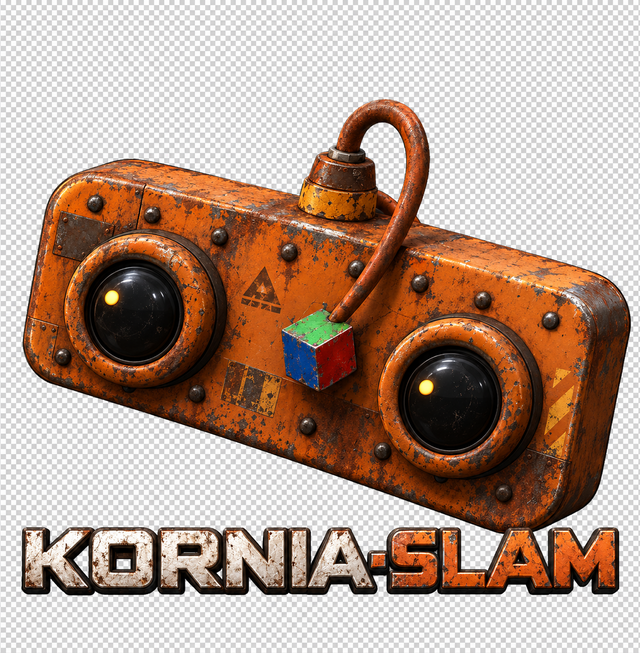
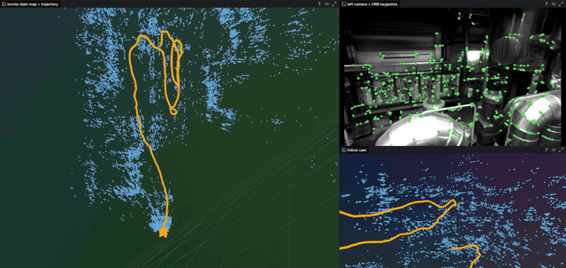
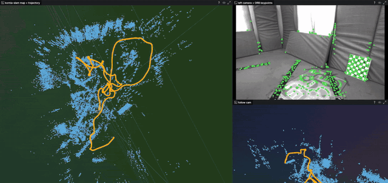

<div align="center">



# kornia-slam

Real-time visual-inertial SLAM in Rust, built on [kornia-rs](https://github.com/kornia/kornia-rs).

</div>

> **v0.1 — early release.** The API will change between minor versions.

<table>
  <tr>
    <td></td>
    <td></td>
  </tr>
  <tr>
    <td align="center">EuRoC MH_01_easy</td>
    <td align="center">EuRoC V1_01_easy</td>
  </tr>
</table>

<sub>Stereo + IMU at 2× speed. Each shows the map and trajectory, the left camera with its ORB
keypoints, and a follow view.</sub>

## Features

- Monocular, stereo, and visual-inertial ORB SLAM
- Local bundle adjustment, including visual-inertial BA
- Place recognition (DBoW2) and loop closure with pose-graph optimization
- Sources: EuRoC, Hilti, MCAP, OAK-D, UVC webcams
- Terminal UI, Rerun streaming, ATE/RPE evaluation

See [ROADMAP.md](ROADMAP.md) for what's next.

## Install

### Prebuilt binaries (v0.1.0)

Linux x86_64 and aarch64 builds need glibc 2.35+ (Ubuntu 22.04+, Jetson JetPack 6):

```bash
TARGET=x86_64-unknown-linux-gnu   # or aarch64-unknown-linux-gnu
NAME=kornia-slam-v0.1.0-$TARGET
curl -L --remote-name-all https://github.com/kornia/kornia-slam/releases/download/v0.1.0/$NAME.tar.gz{,.sha256}
sha256sum -c $NAME.tar.gz.sha256
tar -xzf $NAME.tar.gz

# stereo + IMU on an EuRoC sequence, with evaluation against ground truth
./$NAME/kornia-slam euroc --data /path/to/MH_01_easy --stereo --imu --evaluate
```

The archive holds the binary, `README.md`, `CHANGELOG.md` and `LICENSE`.

The v0.1.0 binary predates run files: it takes a source subcommand and flags
(`kornia-slam --help`, `kornia-slam euroc --help`) rather than the `--config`
run files described below. Global options go before the subcommand, e.g. loop
closing with the vocabulary from [Quick start](#quick-start):
`kornia-slam --vocab /path/to/ORBvoc.txt --apply-pgo euroc …`.

It is built with the default features: Rerun streaming (`--rerun-stream`, which
needs the `rerun` 0.29.2 viewer on `PATH`, e.g. `pip install rerun-sdk==0.29.2`)
is in, live OAK-D and UVC cameras are not. Build from source with
`--features oakd` or `--features uvc` for those; OAK-D has extra prerequisites,
see [apps/kornia-slam-app](apps/kornia-slam-app/README.md#oak-d-camera).

### From source

The app needs Rust 1.91+ (the libraries 1.89+). Build and run with Cargo as in
[Quick start](#quick-start), or with [Pixi](https://pixi.sh), which provides the
toolchain:

```bash
pixi run rust-run -- --config configs/euroc.ron
pixi run rust-lint
pixi run rust-test
```

## Quick start

Download a [EuRoC](https://projects.asl.ethz.ch/datasets/doku.php?id=kmavvisualinertialdatasets)
sequence (ASL format) to `data/euroc/MH_01_easy`, or edit the `data` path in
the run file, then:

```bash
# monocular
cargo run --release -p kornia-slam-app -- --config configs/euroc.ron

# stereo + IMU with loop closing, with evaluation against ground truth
cargo run --release -p kornia-slam-app -- --config configs/euroc-stereo-imu-loop.ron --evaluate
```

Loop closing needs ORB-SLAM3's vocabulary: extract `Vocabulary/ORBvoc.txt.tar.gz`
from [ORB-SLAM3](https://github.com/UZ-SLAMLab/ORB_SLAM3) to `weights/ORBvoc.txt`.

A run file names the source and the system to run on it; see
[apps/kornia-slam-app](apps/kornia-slam-app/README.md#run-files).

More sources and options: [apps/kornia-slam-app](apps/kornia-slam-app/README.md).

## Library

A system configuration and the source's calibrated rig build a `SlamSystem`,
which then takes IMU samples and images as they arrive and returns poses. Feature extraction,
stereo matching and frame history are the system's; sources supply
synchronized, calibrated (and, for stereo, rectified) images.

```rust,ignore
use kornia_slam::{CameraSelection, SensorSelection, SlamSystem, SystemConfig};

let config = SystemConfig {
    sensors: SensorSelection { cameras: CameraSelection::Stereo, imu: true },
    ..SystemConfig::default()
};
let mut system = SlamSystem::build(config, rig)?; // rig: kornia_slam::SensorRig
for (idx, frame) in frames.enumerate() {
    system.process_imu(&frame.imu);
    let result = system.process_stereo(frame.timestamp_sec, &frame.left, &frame.right)?;
    println!("{idx}: {:?} {:?}", result.status, result.pose_world_to_cam);
}
```

With the `serde` feature, `SystemConfig::from_ron_file` reads the same settings
from a RON file, the `system` section of a run file.

## Integrations

- **[Copper](https://github.com/copper-project/copper-rs):** stereo visual-inertial odometry as
  Copper tasks via [cu-kornia-vio](https://github.com/kornia/cu-kornia-vio). See
  [INTEGRATIONS.md](INTEGRATIONS.md#copper) for setup, graph wiring and timing requirements.

## Development

With [Pixi](https://pixi.sh), which sets up the toolchain for you:

```bash
pixi run rust-lint           # fmt + clippy + check
pixi run rust-test           # workspace tests
pixi shell                   # drop into the environment
```

Or with a Rust toolchain (1.91+; the library crates alone need 1.89) installed yourself:

```bash
cargo fmt --all -- --check
cargo clippy --all-targets -- -D warnings
cargo test --workspace
```

## Paper

**Kornia-SLAM: An End-to-End Visual-Inertial SLAM System in Rust**\
Christie J. Purackal, Edgar Riba, Astik Srivastava.\
Rust for Robotics workshop at IROS 2026 (preprint).\
[Paper (PDF)](https://github.com/kornia/kornia-slam/releases/download/v0.1.0/kornia-slam-iros2026-r4r-paper.pdf) · [Poster (PDF)](https://github.com/kornia/kornia-slam/releases/download/v0.1.0/kornia-slam-iros2026-r4r-poster.pdf)

The paper's EuRoC results come from the August 2026 code, before v0.1.0. To cite
kornia-slam, use GitHub's "Cite this repository" button, which reads
[CITATION.cff](CITATION.cff).

## License

Apache-2.0
